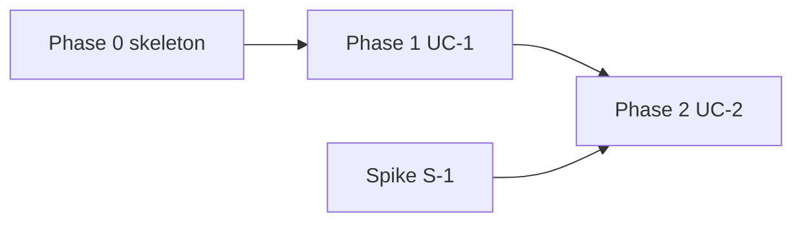

# Templates

Copy these structures. Replace everything in `<angle brackets>`. Delete optional sections that do not apply rather than leaving them empty.

---

## PLAN.md

```markdown
# Implementation Plan: <system name>

Architecture: `docs/architecture/README.md` (ADRs in `docs/architecture/adr/`, deferrals in `docs/architecture/deferred.md`)
Requirements: <path to PRD, or "none, architecture only">
Plan status: <Draft | Approved on YYYY-MM-DD>
Detail level: Phases 0-<n> fully detailed; phases <n+1>-<m> at title-and-acceptance level, detailed at the preceding gate.

## How to use this plan

An executing session reads `PROGRESS.md`, then the current phase file only. Take the next task whose dependencies are done, implement it, run its Verify commands plus the full suite and boundary check, commit with the task ID, and update `PROGRESS.md` in the same commit. Stop at every phase gate.

## Inventory

| ID | Kind | Name | Layer | Architecture ref | Built in |
|----|------|------|-------|------------------|----------|
| E-1 | Entity | <name> | Entities | README §<x> | P1-T01 |
| UC-1 | Use case | <name> | Use cases | README §<x>, ADR-000<n> | P1-T03 |
| P-1 | Port | <name> | Use cases (interface) | README §<x> | P1-T03 |
| A-1 | Adapter (implements P-1) | <tech> <name> | Interface adapters | ADR-000<n> | P1-T06 |
| D-1 | Delivery | <CLI / HTTP / UI> | Frameworks & drivers | README §<x> | P1-T08 |
| X-1 | Cross-cutting | Error model | all | ADR-000<n> | P0-T05 |

## Layers and the dependency rule

| Layer | Directory | May import | Must never import |
|-------|-----------|------------|-------------------|
| Entities | `<path>` | stdlib only | everything else |
| Use cases | `<path>` | entities | adapters, delivery, frameworks, DB, network |
| Interface adapters | `<path>` | use cases, entities | delivery |
| Frameworks & drivers / delivery | `<path>` | anything inward | — |
| Main (composition root) | `<path>` | everything | — (nothing imports Main) |

Enforced by: `<tool>`, run as `<command>`.

## Phases

| Phase | Goal (one sentence a non-engineer can verify) | Slices / use cases | Tasks | File |
|-------|-----------------------------------------------|--------------------|-------|------|
| 0 | <A trivial request runs end to end through every layer and CI is green> | skeleton | <n> | `phase-0-skeleton.md` |
| 1 | <goal> | UC-1 | <n> | `phase-1-<slug>.md` |

## Dependency graph



## Risks and how the sequence addresses them

| Risk | Likelihood / impact | Addressed by |
|------|---------------------|--------------|
| <unfamiliar API X> | <H/H> | Spike S-1 in Phase 1, before UC-2 depends on it |

## Spikes

| ID | Question | Time box | Feeds decision | Scheduled |
|----|----------|----------|----------------|-----------|
| S-1 | <Can SDK X do Y within Z ms?> | <one session> | <adapter choice for P-2> | Phase 1 |

## HUMAN tasks

| ID | What | Blocks | Needed by | Start |
|----|------|--------|-----------|-------|
| H-1 | <Create account / obtain API key for X> | P2-T05 | Phase 2 | Now |

## Assumptions

- <Small gap resolved by assumption, with the reason. Revisit if <trigger>.>

## Open questions (need the user's answer)

1. <Large gap. What is blocked until it is answered.>

## Deferred decisions honored

- <Decision from deferred.md>: planned around with <fake / partial boundary>; the forcing task is <ID>, triggered by <trigger>.
```

---

## PROGRESS.md

```markdown
# Progress

Current phase: <n> — <phase goal>
Next task: <Pn-Tnn>
Last updated: <YYYY-MM-DD> by <task ID or "planning">

## Status

Legend: `[ ]` todo · `[~]` in progress · `[x]` done · `[!]` blocked (reason in Notes) · `[-]` dropped (see deviations)

### Phase 0 — <goal>
- [ ] P0-T01 <title>
- [ ] P0-T02 <title>
- [ ] GATE 0

### Phase 1 — <goal>
- [ ] P1-T01 <title>
- [ ] GATE 1

## Notes

- <Blocked reasons, findings an executing session must know.>

## Deviations log

| Date | Task | What changed in the plan | Why |
|------|------|--------------------------|-----|
```

---

## phase-N-<slug>.md

```markdown
# Phase <N>: <goal>

Goal: <one sentence a non-engineer can verify>
Detail level: <Full | Outline — detail at Gate <N-1>>
Traces to: <UC / inventory IDs covered>
Prerequisites: <Gate N-1 passed; HUMAN tasks done>

## Tasks

### P<N>-T<nn> — <title>

- **Traces to:** <E-1, UC-1, ADR-0003>
- **Layer:** <Use cases> — must not import <adapters, delivery, frameworks, DB, network>
- **Depends on:** <P<N>-T<nn> | none>
- **Size:** <S | M | L> <PARALLEL-OK>
- **Context:** <Two or three sentences a cold reader needs. What this is, why it exists, where it sits.> See `docs/architecture/README.md` §<x>, ADR-<n>.
- **Files:**
  - create `<path>`
  - modify `<path>`
- **Acceptance criteria:**
  - [ ] <Observable behavior: "returns `X` when Y">
  - [ ] <...>
- **Verify:**
  ```bash
  <exact command, e.g. pytest tests/unit/test_invoice.py -q>
  ```

### SPIKE S-<n> — <question>  (only for spikes)

- **Question:** <the one thing to find out>
- **Time box:** <one session>
- **Feeds decision:** <what changes depending on the answer>
- **Deliverable:** a short written answer appended to `PLAN.md` § Spikes, and the decision recorded (ADR via `/architect` if architectural). Spike code lives on a throwaway branch and is not merged.

### HUMAN H-<n> — <title>  (only for human tasks)

- **What the user must do:** <steps>
- **Blocks:** <task IDs>
- **Done when:** <observable: "env var X is set in the environment", "account exists">

## Gate <N>

- **Exit criteria:**
  - [ ] Full suite green: `<command>`
  - [ ] Boundary check green: `<command>`
  - [ ] Phase acceptance test(s) green: `<command>`
- **Demo:**
  ```bash
  <exact command(s) showing the phase goal working>
  ```
  Expected: <what the user should see>
- **Human checkpoint:** <what the user should look at and decide before Phase N+1>
- **Detail next phase:** at this gate, expand Phase <N+1> from outline to full task specs.
```

Outline-level task (for later phases):

```markdown
### P<N>-T<nn> — <title>
- **Traces to:** <IDs> · **Size:** <S|M|L>
- **Acceptance:** <one or two observable criteria>
```

---

## CLAUDE.md pointer (propose, do not write without asking)

```markdown
## Implementation plan

This project is built from `docs/implementation-plan/`. Before writing code:
1. Read `docs/implementation-plan/PROGRESS.md`, then only the current phase file.
2. Take the next task whose dependencies are done; read the architecture sections it cites.
3. Run the task's Verify commands, the full test suite, and the boundary check.
4. Commit with the task ID in the message and update PROGRESS.md in the same commit.
5. Stop at phase gates for human review. If the plan is wrong, record it in the deviations log; if the architecture is wrong, stop and ask.
```
