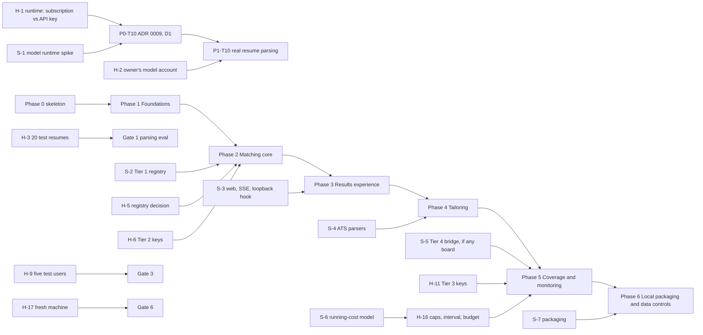

# Implementation Plan: AI Job Matchmaker

Architecture: `docs/architecture/README.md` (ADRs in `docs/architecture/adr/`, deferrals and watch list in `docs/architecture/deferred.md`)
Requirements: `docs/prd.md` (requirement IDs RP, PF, IN, DS, MR, NF, TR, MN, AB-1 to AB-5; Flows 1 to 8; six-phase release plan). **Scope revision of 2026-11-11:** a personal tool that runs only on the owner's machine, for the owner and a few friends; no accounts, trial, billing or hosting (PRD banner and Change log; ADRs 0014, 0015, 0016).
Plan status: Draft (2026-11-11), amended 2026-11-11 for the scope revision, awaiting approval
Detail level: Phases 0 to 2 fully detailed. Phases 3 to 6 at title-and-acceptance level; each is detailed at the preceding gate.
Calendar: no date is set. The plan uses phases, tasks and S/M/L sizes only. Calibrate throughput after Gate 0 and Gate 1.

## How to use this plan

An executing session reads `PROGRESS.md`, then the current phase file only. Take the next task whose dependencies are done, read the architecture sections it cites, implement it, run its Verify commands plus `pnpm verify`, commit with the task ID in the message, and update `PROGRESS.md` in the same commit. Stop at every phase gate for the human checkpoint. A `HUMAN` task is done only when the user says so; never simulate one.

## Starting point (the real code, re-surveyed 2026-11-11 after the scope revision)

This is not a greenfield build. The Architect left a working skeleton and, with ADRs 0014 to 0016, reshaped it for local, personal use:

| Area | State |
|---|---|
| Toolchain | Node 22 type stripping, pnpm workspaces, TypeScript 6 type-check per package, no build step. `pnpm verify` = typecheck + architecture check + tests. **Green** on the working tree (7 components, 87 files, 22 tests). No CI, no formatter, no CLAUDE.md. |
| Enforcement | `tools/architecture/check.mjs` with rules as data in `components.mjs` (areas now include use-cases `profiles` and `spending`, delivery `spending` and `local-only`, adapters `data-controls`). It has no regression tests of its own and scans only `src/` and `test/`. |
| Rules (`packages/rules`) | Implemented and pure: gates, evidence rule, Fit, Confidence, Job Quality, verdict, primary reason, priority, distance and lever, selling-point tier, Resume Strength weights, keyword coverage, tailoring guard, duplicate identity (first stage), **`Person`** (`rules/profile/person.ts`), **`MonthlyBudget`, `budgetStatus`, `monthContaining`** (`rules/spending`). `rules/access` is deleted (ADR 0014). Open hand-off: personal-token redaction in `toScoringProfile`. |
| Use cases | Built: `RunJobSearch` (widening, Tier 3 fallback, Tier 4 off until switched on), `ScoreJobs`, `RescoreAll`, `RunFullAnalysis`, `RecheckStoredPostings`, `ListResults`, `ViewJobDetail`, `RecordJobDecision`, `RunDueMonitoring` (12 h due rule, 14 days unopened pause, budget pause), `ViewInbox`, `OperateSources`, **profiles** (`CreatePerson`, `RenamePerson`, `ListPeople`, `OpenPerson`, `ExportPersonData`, `DeletePerson`), **spending** (`ViewRunningCost`, `SetMonthlyBudget`), **`SpendingGuard`** in `shared` (daily caps, owner-wide budget). Stubs (`notYetBuilt`): `IntakeResume`, `CorrectProfile`, `ConductInterview`, `ReviewNotAFit`, `TailorResume`. The whole `account` area is deleted; `userId` is `personId` everywhere. |
| Adapters | `InMemoryStore` (also `People`, `MonitoringRoster`, `MonthlyBudgetControl`, `PersonDataVault`), `InMemoryUsageLedger`, `InMemorySpendLedger`, `InMemoryProductEventLog`, `AsyncSpendMeter`, `JsonArchiveVault` (`data-controls`), `SystemClock`, `RandomIds`, `InProcessWorkQueue`, **`IntervalTicker`** (`work`), `TemplateNarrator`. Shells: `UnchosenModelRuntime`, `GreenhouseBoardSource`, `JobSpyBoardSource`. |
| Delivery | `ResultsController`, results presenter and view models, `presentRunningCost` (`spending`), `acceptsLocalRequest` and `LOOPBACK_BIND_ADDRESS` (`local-only`). The access presenter is deleted. |
| Main | `composeMatchmaker` wires 18 interactors and the `SpendingGuard`; `main.dev.ts` composes the in-memory configuration with a `JsonArchiveVault` over four stores, starts the monitoring `IntervalTicker` (catch-up tick, then every 15 minutes, not keeping the process alive) and prints the interactor names. No request travels through it yet. |
| Testing API | `MatchmakerTestingApi` composes the real Main with scripted judge and sources; profiles, spending, `switchSource`, `appStarts`, `localRequestAccepted` superpowers; 22 tests across 9 files. Two gaps remain from P0-T04: background errors are thrown inside the queue's chain, and `operatorConsole` mutates the store with `Object.assign`. |

## Inventory

Existing items are marked **exists**; "Built in" names the task that completes or verifies them. "done (architect)" means the Architect built and tested it; no plan task remains.

### Entities (`packages/rules/src`)

| ID | Name | Architecture ref | State | Built in |
|----|------|------------------|-------|----------|
| E-1 | `ProfileVersion`, `Evidence`, `Preferences`, `profileVersionKey` (keyed by `personId`) | README "Critical Business Rules", ADR 0005, ADR 0014 §2 | exists | P1-T04 (exercised) |
| E-2 | `ScoringProfile` brand and `toScoringProfile` | ADR 0007 §1 | exists; redaction hand-off open | P2-T02 |
| E-3 | Selling-point tier and selection (5 to 8) | PRD RP-4 | tier exists; selection new | P1-T03 |
| E-4 | Resume Strength weights | PRD Resume Strength | exists | P1-T04 (exercised) |
| E-5 | Common job schema `JobPosting` with revision | ADR 0005 §2 | exists | P2-T03 |
| E-6 | Duplicate identity and source-link merge | PRD pipeline step 4 | first stage exists; description similarity new | P2-T03 |
| E-7 | Hard gates | ADR 0002 | exists | P2-T01 |
| E-8 | Evidence rule (`enforceEvidence`) | ADR 0002, 0007 | exists | P2-T01 |
| E-9 | Fit, Confidence, Job Quality, priority | ADR 0002 | exists | P2-T01 |
| E-10 | Verdict, primary reason, distance to Apply, biggest lever | ADR 0002 | exists | P2-T01 |
| E-11 | ATS keyword coverage | ADR 0002 | exists | P4 |
| E-12 | Tailoring guard | ADR 0007 §3 | exists | P4 |
| E-13 | `Person` (`personId`, `displayName`, `createdAt`, `normalizeDisplayName`); replaces the access policy | README "profile/", ADR 0014 §2 | exists | done (architect; `profiles.test.ts`) |
| E-14 | Seniority ladder; suggested target band (RP-6, PF-5 defaults) | PRD Hard gates | ladder exists; suggestion new | P1-T03 |
| E-15 | Points lost and "what would change this verdict" (report parts 5 and 6) | PRD Report contents | new (assumption: belongs in `rules/matching`) | P3 |
| E-16 | `MonthlyBudget`, `budgetStatus`, `validMonthlyBudget`, `monthContaining` (calendar month, UTC) | README "spending/", ADR 0015 §1 | exists | done (architect; `spending.test.ts`) |

### Use cases (`packages/use-cases/src`)

| ID | Name | Area | State | Built in |
|----|------|------|-------|----------|
| UC-1 | `IntakeResume` | onboarding | stub; needs `SpendingGuard` (on demand, uncapped) | P1-T04 |
| UC-2 | `CorrectProfile` (facts, selling points; preferences) | onboarding | stub | P1-T05 (facts), P2-T15 (preferences), P3 (screens, Fix a fact) |
| UC-3 | `ConductInterview` | onboarding | stub; needs `SpendingGuard` (on demand, uncapped) | P3 |
| UC-4 | `RunJobSearch` | discovery | exists (guard, Tier 4 off by default); dedup and revision hand-off | P2-T03 |
| UC-5 | `RecheckStoredPostings` | discovery | exists | P2-T04 (liveness), P5 (daily, on the ticker) |
| UC-6 | `ScoreJobs` | matching | exists | P2-T01 |
| UC-7 | `RescoreAll` | matching | exists; reuse optimization hand-off | P1-T05 (requested), P3 |
| UC-8 | `RunFullAnalysis` | matching | exists; supersede hand-off | P3 |
| UC-9 | `ListResults` | results | exists | P2-T01, P3 |
| UC-10 | `ViewJobDetail` | results | exists (ADR 0012); presenter and screen in P3 | P3 |
| UC-11 | `ReviewNotAFit` | results | stub | P3 |
| UC-12 | `RecordJobDecision` | results | exists | P3 |
| UC-13 | `TailorResume` | tailoring | stub; guard in its dependencies (daily cap `tailoredResumes`) | P4 |
| UC-14 | `RunDueMonitoring` | monitoring | exists: roster from the store, catch-up at start, 14 days unopened, budget pause | done (architect; `monitoring.test.ts`); real roster store in P3-T08 |
| UC-15 | `ViewInbox` | monitoring | exists; no `InboxSource` adapter | P5 |
| UC-16 | `CreatePerson`, `RenamePerson` | profiles | exists | done (architect); screens P3-T10 (create), P6-T01 (rename) |
| UC-17 | `ListPeople`, `OpenPerson` (records `lastOpenedAt`, MN-4) | profiles | exists | done (architect); picker P3-T10, full list P6-T01 |
| UC-18 | `ExportPersonData`, `DeletePerson` (spend kept with null person) | profiles | exists; W16 cancel hand-off | done (architect) for in-memory stores; P6-T02 (screens), P6-T05 (W16), P6-T06 (every local store) |
| UC-19 | `ViewRunningCost` (per profile, "other", total, budget status, monitoring paused) | spending | exists | done (architect); screen P6-T03 |
| UC-20 | `SetMonthlyBudget` | spending | exists | done (architect); screen P6-T04 |
| UC-21 | `SpendingGuard` (`beforeOnDemand`, `beforeBackground`, `monthlyBudgetReached`; `DAILY_CAPS`) | shared | exists; called by `RunJobSearch`, `RunDueMonitoring` | done (architect); wired into UC-1 (P1-T04), UC-3 (P3-T02), UC-13 (P4-T03); "ask first" dialog P6-T04 |
| UC-22 | `OperateSources` | operations | exists | P5 |

### Ports (owned by use cases)

| ID | Port(s) | Owner | Fake | Real adapter |
|----|---------|-------|------|--------------|
| P-1 | `Clock`, `IdGenerator` | shared | testing API | `SystemClock`, `RandomIds` (exist) |
| P-2 | `PeopleForSpending`, `UsageLedger`, `MonthlyBudgetSetting` (guard-owned); `People` (extends `PeopleForSpending`) | shared, profiles | `InMemoryStore`, `InMemoryUsageLedger` (exist) | A-22 local database (P3-T08) |
| P-3 | `DocumentReader` | onboarding | testing API (P1-T02) | A-15 (P1-T08, P1-T09) |
| P-4 | `ResumeAnalyst` | onboarding | testing API (P1-T02) | A-7 (P1-T10) |
| P-5 | `Interviewer` | onboarding | testing API (P3) | A-12 (P3) |
| P-6 | `ResumeFiles` | onboarding | A-16a in-memory (P1-T01) | A-16b data-folder files (P3-T09) |
| P-7 | `ProfileVersions`, `ProfilesForSearch`, `ProfilesForScoring` | onboarding, discovery, matching | `InMemoryStore` | A-22 (P3-T08) |
| P-8 | `InterviewTranscripts` | onboarding | in-memory (P3) | A-22 (P3) |
| P-9 | Request ports `SearchRequests`, `RescoreRequests`, `ScoringRequests`, `MonitoringSearchRequests` | onboarding, discovery, monitoring | `InProcessWorkQueue` via Main | stays in-process; A-25 only if D4 fires |
| P-10 | `JobSource` | discovery | testing API | A-17 to A-20 (P2, P5) |
| P-11 | `SourceSwitchboard` (null = never switched; Tier 4 then off), `SourceSwitchControl` | discovery, operations | `InMemoryStore` | A-26 in the local database (P3-T08) |
| P-12 | `SearchPlanner` | discovery | testing API | A-9 (P2-T11) |
| P-13 | `PostingEnricher` | discovery | testing API | A-10 (P2-T11) |
| P-14 | `RelevanceRanker` | discovery | testing API | A-11 (P2-T13) |
| P-15 | `PostingCatalog`, `PostingsForScoring` | discovery, matching | `InMemoryStore` | A-22 (P3-T08) |
| P-16 | `PostingLiveness` | discovery | testing API | A-21 (P2-T04) |
| P-17 | `SearchRuns`, `SearchRunHistory` (with `runId` and `costMicros`, ADR 0010) | discovery, operations | `InMemoryStore` | A-22 (P3-T08) |
| P-18 | `AtsLinkRecognizer`, `CompanyRegistry` | discovery | `InMemoryStore` | Tier 1 adapters; A-22 |
| P-19 | `MatchJudge` | matching | testing API | A-8 (P2-T12) |
| P-20 | `MatchNarrator` | matching | — | `TemplateNarrator` (exists); model narrator only on W4 trigger |
| P-21 | `MatchRecords` | matching | `InMemoryStore` | A-22 (P3-T08) |
| P-22 | `ResultsFeed` (output port) | matching | testing API | A-27 server-sent events in `apps/web` on localhost (P3) |
| P-23 | `ResultsReadModel` | results | `InMemoryStore` | A-22 (P3-T08) |
| P-24 | `TailoringSources`, `TailoredResumes` | tailoring | in-memory (P4) | A-22 (P4) |
| P-25 | `KeywordMatcher` | tailoring | testing API (P4) | A-13 (P4) |
| P-26 | `ResumeWriter` | tailoring | testing API (P4) | A-14 (P4) |
| P-27 | `ResumeRenderer` | tailoring | testing API (P4) | A-23 (P4) |
| P-28 | `GeneratedFiles` | tailoring | in-memory (P4) | A-24 data-folder files (P4) |
| P-29 | `MonitoringRoster` (`peopleWithMonitoringOn`), `InboxSource` | monitoring | `InMemoryStore` roster (exists); inbox in-memory (P5) | A-22 (P3-T08 roster, P5 inbox) |
| P-30 | `MonthlyBudgetControl` (extends `MonthlyBudgetSetting`), `PeopleForRunningCost` (replaces `Checkout`) | spending | `InMemoryStore` (exists) | A-22 (P3-T08) |
| P-31 | `PersonDataVault` (`exportAll`, `eraseAll`; replaces `UserDataVault`) | profiles | every in-memory store implements it (exists) | every local store implements it: A-22, A-16b, A-24 (P3, P4); completeness P6-T06 |
| P-32 | `SpendMeter`, `SpendAttribution`, `SpendLedger` (`totalSpent` read by the guard; ADR 0010, 0015) | shared | `AsyncSpendMeter`, `InMemorySpendLedger` (exist) | `AsyncSpendMeter` stays; ledger in A-22 (P3-T08) |
| P-33 | `ProductEvents` (ADR 0011) | measurement | `InMemoryProductEventLog` (exists) | D14 decided (ADR 0016): stored locally by A-22 (P3-T14); never a vendor |
| P-34 | Cancel a person's queued background work (W16; name chosen in the task) | profiles | testing API (P6-T05) | A-32 on `InProcessWorkQueue` (P6-T05) |

### Adapters, delivery, Main, cross-cutting

| ID | Kind | Name | Layer / package | Ref | Built in |
|----|------|------|-----------------|-----|----------|
| A-1 | Adapter (P-2, P-7, P-11, P-15, P-17, P-18, P-21, P-23, P-29, P-30, P-31) | `InMemoryStore` (exists) | `adapters/in-memory` | ADR 0006, 0014 | P0-T06 (contracts) |
| A-7 | Adapter (P-4) | Resume analyst, model-backed | new model-runtime package | ADR 0003, D1 | P1-T10 |
| A-8 | Adapter (P-19) | Match judge, model-backed | model-runtime package | ADR 0002, 0003 | P2-T12 |
| A-9, A-10 | Adapter (P-12, P-13) | Search planner, posting enricher | model-runtime package | ADR 0003 | P2-T11 |
| A-11 | Adapter (P-14) | Relevance ranker | model-runtime package or adapters | D3 | P2-T13 |
| A-12 | Adapter (P-5) | Interviewer | model-runtime package | W7 | P3 |
| A-13, A-14 | Adapter (P-25, P-26) | Keyword matcher, resume writer | model-runtime package | ADR 0007 | P4 |
| A-15 | Adapter (P-3) | Document reader: text, DOCX, PDF, LinkedIn PDF, OCR | new `@matchmaker/documents` (W2 split) | D9 | P1-T08, P1-T09 |
| A-16 | Adapter (P-6, P-31) | Resume files: in-memory (a); files in the owner's data folder (b), no application-level encryption (Privacy 1 relies on disk encryption) | adapters | D8, ADR 0016 §6 | P1-T01 (a), P3-T09 (b) |
| A-17 | Adapter (P-10, P-18) | Tier 1 ATS: Greenhouse, Lever, Ashby, Workable, SmartRecruiters, Recruitee | `adapters/job-sources` | ADR 0004 | P2-T05 to P2-T07 |
| A-18 | Adapter (P-10) | Tier 2: Remotive, RemoteOK, Arbeitnow, Jobicy, Himalayas, The Muse, Adzuna, USAJobs, We Work Remotely, HN Who's Hiring | `adapters/job-sources` | ADR 0004 | P2-T08 to P2-T10 |
| A-19 | Adapter (P-10) | Tier 3: JSearch, SerpApi, TheirStack, Apify (normally run, since Tier 4 is off by default) | `adapters/job-sources` | ADR 0004, 0016 §4 | P5 |
| A-20 | Adapter (P-10) | Tier 4 scraping, off by default, only for boards the owner turns on; rate limit and on/off switch; no proxy pool; never a logged-in account | `scraping-sources` (optional per installation) | ADR 0004, 0016, D11, W6 | P5 (conditional on open question 1) |
| A-21 | Adapter (P-16) | HTTP posting liveness | `adapters/job-sources` | — | P2-T04 |
| A-22 | Adapter (all storage gateways, including `People`, `UsageLedger`, `MonthlyBudgetControl`, `MonitoringRoster`, `SpendLedger`, `ProductEvents`, `PersonDataVault`) | Local database: SQLite through Node's built-in `node:sqlite` (default candidate) or Postgres with pgvector only if embeddings need it; the file lives in the data folder | new `@matchmaker/storage-sqlite` (or `storage-postgres`) | D2, D8, ADR 0016 §6 | P3-T08 |
| A-23 | Adapter (P-27) | ATS-safe PDF and DOCX renderer | `@matchmaker/documents` | D9 | P4 |
| A-24 | Adapter (P-28, P-31) | Generated files in the data folder | adapters | D8 | P4 |
| A-25 | Adapter (P-9) | Worker-process queue | adapters or own package | D4, W5 | **not planned**; only if a D4 trigger fires |
| A-26 | Adapter (P-11) | Source switch store | with A-22 | D10 | P3-T08 |
| A-27 | Adapter (P-22) | Server-sent events results feed on localhost | `apps/web` | D5 | P3 |
| A-28 | Adapter (P-31) | `JsonArchiveVault`: composes every store's `PersonDataVault` into one JSON archive, one section per store (exists; replaces the billing checkout) | `adapters/data-controls` | ADR 0014 §4 | done (architect) for in-memory stores; local stores join in P3-T08, P3-T09, P4, checked in P6-T06 |
| A-29 | Adapter (P-32) | `AsyncSpendMeter` and `InMemorySpendLedger` (exist) | `adapters/metering`, `adapters/in-memory` | ADR 0010 | done |
| A-30 | Adapter (P-33) | `InMemoryProductEventLog` (exists, implements `PersonDataVault`); local destination is a table in A-22 (D14 decided, ADR 0016) | `adapters/in-memory`, A-22 | ADR 0011, 0016 | P3-T14 |
| A-31 | Adapter | `IntervalTicker` (catch-up tick at start, then every `MONITORING_TICK_MS`; exists) | `adapters/work` | ADR 0016 §3 | done (architect); kept alive in the local web Main (P3-T10) |
| A-32 | Adapter (P-34) | Cancel-by-person on the work queue | `adapters/work` | W16 | P6-T05 |
| D-1 | Delivery | Results controller and presenters (exist) | delivery | README | P2-T01 |
| D-2 | Delivery | Running-cost presenter `presentRunningCost` (exists; replaces the access presenter) | `delivery/spending` | ADR 0015 §6 | done (architect); screen P6-T03 |
| D-3 | Delivery | Onboarding controllers and presenters (selling-points card, corrections) | `delivery/onboarding` | ADR 0001 §7 | P1-T07 |
| D-4 | Delivery | Preferences and interview controllers and presenters | `delivery/onboarding` | — | P3 |
| D-5 | Delivery | Job detail and Not a fit presenters | `delivery/results` | — | P3 |
| D-6 | Delivery | Tailoring presenter | `delivery/tailoring` | — | P4 |
| D-7 | Delivery | Inbox presenter; the owner's sources screen | `delivery/monitoring`, `delivery/operations` | — | P5 |
| D-8 | Frameworks and drivers | `apps/web`, the local web Main: binds `127.0.0.1` only, runs `acceptsLocalRequest` in one request hook before every handler (W15), route handlers as humble objects, screens, a minimal profile picker; **no authentication** (ADR 0014 §5) | `apps/web` (a Main) | D5, ADR 0016 §2 | P3-T10, screens P3 to P6 |
| D-9 | Frameworks and drivers | `apps/worker`, a second local Main | `apps/worker` | D4, W5 | **not planned**; only if a D4 trigger fires |
| D-10 | Frameworks and drivers | Dev drivers (`smoke`, `intake`, `search`) | `apps/main/src/main.dev.ts` | README "Main" | P0-T05, P1-T12, P2-T16 |
| D-11 | Delivery | Local-request check `acceptsLocalRequest`, `LOOPBACK_BIND_ADDRESS` (exist) | `delivery/local-only` | ADR 0016 §2, AB-5 | done (architect; `local-only.test.ts`); called by D-8 (P3-T10) |
| D-12 | Delivery | Profile-management and spending controllers and presenters (list, rename, export, delete; budget; "ask first") | `delivery/profiles`, `delivery/spending` | ADR 0014, 0015 §5 | P6-T01 to P6-T04 |
| M-1 | Main | `composeMatchmaker` | `apps/main` | README "Main" | every slice |
| M-2 | Main | Testing API (`MatchmakerTestingApi`) | `packages/testing-api` | ADR 0008 | P0-T04, every slice |
| M-3 | Main | The owner's local configuration (replaces per-market configurations): local database and data folder, chosen runtime with the owner's credential, loopback only, ticker kept alive | `apps/web` | ADR 0016, D5, D15 | P3-T10, P6-T08 |
| X-1 | Cross-cutting | Error model (`UseCaseError`; codes include `daily-cap-reached`, `monthly-budget-reached`) | use-cases/shared | ADR 0015 | P0-T04 (verify), P1-T04 |
| X-2 | Cross-cutting | Configuration and the owner's credentials: typed local configuration loader in Main (environment or a gitignored local file); no secrets store | Main | ADR 0016 §5 | P1-T10 |
| X-3 | Cross-cutting | Boundary enforcement (typecheck, check, metrics) | tools | ADR 0001 §5 | P0-T02, P0-T03 |
| X-4 | Cross-cutting | CI | `.github/workflows` | — | P0-T09 |
| X-5 | Cross-cutting | Evaluation harness (parsing, stability, ATS parse, coverage) | `apps/main/eval` (a Main configuration) | ADR 0002, 0008 | P0-T07, P1-T11, P2-T14, P4 |
| X-6 | Cross-cutting | Adapter contract suites (every store's suite includes "erase leaves nothing of the person") | `packages/testing-api/contract` | ADR 0014 Consequences | P0-T06 and every adapter task |
| X-7 | Cross-cutting | Local-only data (Privacy 1, AB-5): loopback bind plus the local-request check; all data in the owner's data folder; no application-level encryption (the machine's disk encryption) | D-11, A-16b, A-22, M-3 | ADR 0016 | D-11 done; P3-T08, P3-T09, P3-T10; stated in the owner's README (P6-T08) |
| X-8 | Cross-cutting | Fairness redaction | rules | ADR 0007 | P2-T02 |
| X-9 | Cross-cutting | The owner's model account configured so data is not used for training (Privacy 4) | Main configuration | ADR 0016 §5 | H-2 |
| X-10 | Cross-cutting | Schema versioning of the local database file (forward-only, applied at start) | A-22 | D2 | P3-T08 |
| X-11 | Cross-cutting | Formatting and lint | root | — | P0-T08 |
| X-12 | Cross-cutting | Spend metering and spending limits: every paid adapter records through `SpendMeter`; every cost-incurring use case charges and calls `SpendingGuard` (watch W8) | adapters, use cases | ADR 0010, 0015 | every paid-adapter and cost-incurring task |
| X-13 | Cross-cutting | Product events: measured decorators over input ports, wired in Main; north star from `profile-created` | `use-cases/src/measurement` | ADR 0011, 0014 §6 | every task that wires a measured use case |
| X-14 | Cross-cutting | Packaging: one-command local install and start | repository scripts, M-3 | D15 | S-7, P6-T07, P6-T08 |

## Layers and the dependency rule

| Layer | Directory | May import | Must never import |
|-------|-----------|------------|-------------------|
| Entities | `packages/rules/src` | its own files only | every other package, `node:*`, any library |
| Use cases | `packages/use-cases/src` (areas never import each other; `shared` is open to all) | `@matchmaker/rules` | adapters, delivery, main, `node:*`, any library; another area |
| Interface adapters: delivery | `packages/delivery/src` | `@matchmaker/use-cases` (published types only) | rules, adapters, main, `/wiring`, `node:*`, any library |
| Interface adapters and drivers | `packages/adapters/src`, `packages/scraping-sources/src`, and split packages (`documents`, model runtime, `storage-sqlite`) | rules, use-cases, `node:*`, their own libraries | delivery, main, testing-api, `/wiring`; another adapter subfolder |
| Main | `apps/main/src` (later also `apps/web`) | everything above, including `/wiring` | testing-api (nothing imports a Main except the testing API) |
| Tests | `packages/testing-api` | everything | — (nothing imports it). Tests in `test/` talk only to `MatchmakerTestingApi` (ADR 0008) |

Enforced by: per-package `tsc` with manifest-scoped resolution and `types: []` for inner circles, plus `tools/architecture/check.mjs` (rules as data in `tools/architecture/components.mjs`), run as `pnpm verify`. Changing `components.mjs` needs an ADR; tasks that split a package under watch-list item W2 record it through `/architect`.

## Phases

The PRD's six release phases are kept as phase goals, and their exit tests are the gates. Phase 0 comes first.

| Phase | Goal (one sentence a non-engineer can verify) | Slices / use cases | Tasks | File |
|-------|-----------------------------------------------|--------------------|-------|------|
| 0 | `pnpm verify` and CI are green on every push, a trivial request runs through every layer from the dev Main, and the model runtime decision is recorded | skeleton, X-3 to X-6, D1 decision | 10 + S-1, H-1 | `phase-0-skeleton.md` |
| 1 | **Foundations.** A resume dropped into the dev app for a person's profile becomes a structured profile with a selling-points card and a Resume Strength score. **Exit: 20 varied test resumes parse with correct roles, dates and skills** | UC-1, UC-2 (facts); UC-16 to UC-21 pinned (done) | 12 (1 done) + S-2 | `phase-1-foundations.md` |
| 2 | **Matching core.** A search over real Tier 1 and 2 sources gives every job a verdict. **Exit: score stability holds at 95% on a fixed test set** | UC-2 (preferences), UC-4, UC-5, UC-6, UC-9 | 16 | `phase-2-matching-core.md` |
| 3 | **Results experience.** On the owner's machine, the owner picks or creates a profile in the local web app, finishes onboarding and sees the three tabs. **Exit: five test users reach a first Apply verdict in under 10 minutes** | UC-2, UC-3, UC-7, UC-8, UC-10, UC-11, UC-12; D2, D5, D8, D10 | 15 (outline) | `phase-3-results-experience.md` |
| 4 | **Tailoring.** A person gets a tailored resume per job without anything invented. **Exit: tailored resumes parse cleanly in three common ATS parsers** | UC-13 | 8 (outline) | `phase-4-tailoring.md` |
| 5 | **Full coverage and monitoring.** Tiers 1 to 3 (Tier 4 only for boards the owner turns on), switches without a restart, monitoring while the app runs, and the inbox. **Exit: a run completes with any single source disabled** | UC-5, UC-14 (done), UC-15, UC-22; D10, D11 | 8 (1 done, 1 dropped) + S-5, S-7 (outline) | `phase-5-coverage-and-monitoring.md` |
| 6 | **Local packaging and data controls.** The owner manages profiles, exports and deletes them, sees spend and sets a budget, and installs and starts the app with one command. **Exit: on a fresh machine, the owner installs, starts the app, creates a profile and reaches a first match, then exports and deletes that profile cleanly** | UC-16 to UC-21 (screens), W16; D15 | 9 (outline) | `phase-6-local-packaging-and-data-controls.md` |

## Dependency graph

## Risks and how the sequence addresses them

| Risk | Likelihood / impact | Addressed by |
|------|---------------------|--------------|
| Subscription usage limits slow long runs (many scoring calls per search), or headless output is less structured than needed | M / M | Owner decision H-1 fixes the runtime. S-1 measures throughput and structured output per port; prefilter cap, caching and model tiering bound call counts. ADR 0003 keeps a later change to adapters and Main configuration only. |
| Under the subscription runtime, model calls have no per-call price, so the monthly budget would not bound use | M / M | P0-T10 settles, in ADR 0009, whether the meter reports a priced estimate or zero (ADR 0015 Consequences, review trigger); P1-T10's spend criterion follows it. |
| The PRD's "temperature 0" consistency rule cannot be met literally: current Claude models reject sampling parameters (`temperature`) | H / M | The user approved the replacement (open question 2). S-1 confirms the API fact; ADR 0009 (written in P0-T10) records it. Stability rests on structured output, a fixed rubric, the evidence rule, caching per profile version (ADR 0005) and the rules deciding (ADR 0002); the Phase 2 exit is the measure. |
| Resume parsing quality below the Phase 1 exit | M / H | Parsing eval (P1-T11) runs from the first real adapter; scripted-analyst tests prove the use case independently of model quality. |
| Judge variance breaks the 95% stability target | M / H | Stability eval (P2-T14) runs as soon as A-8 exists; caching makes daily use stable regardless (ADR 0005); calibration stays in rules. |
| Job source endpoints, quotas and terms changed since the PRD | H / M | Every source adapter task starts by verifying the endpoint in current documentation; recorded fixtures keep tests offline; a failing source never fails a run (exists). |
| No initial Tier 1 company registry | H / H (Tier 1 returns nothing) | S-2 and H-5 in Phase 1, before Tier 1 adapters in Phase 2. |
| Running cost grows beyond what the owner wants to pay | M / M | Metering, per-profile spend, daily caps and the owner-wide budget are built (ADR 0010, 0015). S-6 builds a cost model from Phase 2 measurements; H-16 confirms caps, interval and a budget before Phase 5; the spend panel and budget screens arrive in Phase 6, the dev driver can set a budget before that. |
| No login: any web page the owner visits can send requests to `localhost` or rebind its name to `127.0.0.1`, and read friends' resumes | M / H | `acceptsLocalRequest` exists and is tested (ADR 0016). P3-T10 puts it in the framework's single request hook (W15) with a test that a foreign Host or Origin is refused on every route, including framework endpoints; S-3 finds that hook first. |
| A deleted friend's queued search writes matches or spend after erasure (W16) | L / M | P6-T05 adds cancel-by-person before erasure; until then delete is used only in tests and dev. |
| Monitoring runs only while the owner's machine is on | H / L | Catch-up run at start is built (`IntervalTicker`, `monitoring.test.ts`); P3-T10 keeps the ticker alive in the local web Main. |
| JobSpy is a Python library; the stack is TypeScript | H / M (only if a Tier 4 board is wanted) | S-5 in Phase 4 decides a bridge and whether W6 fires, and is skipped if the owner turns on no Tier 4 board (open question 1). Tier 3 covers Tier 4 meanwhile (exists). |
| One-command install fails on a fresh machine (Node version, native builds, missing configuration) | M / H (Phase 6 exit) | Prefer pure-JavaScript libraries and Node built-ins (`node:sqlite`) throughout; `.node-version` pinned in P0-T01; S-7 in Phase 5 chooses packaging; the Phase 6 exit is run on a truly fresh machine (H-17). |
| Web framework and streaming arrive late, threatening the 10-minute test | M / M | S-3 at the end of Phase 2; web work opens Phase 3. Controllers and presenters are framework-free already. |
| The architecture check quietly loosens | L / H | P0-T02 adds regression tests for every rule in the checker. |

## Spikes

Spike code lives on a throwaway branch and is not merged. Each answer is appended below and the decision recorded (ADR via `/architect` when architectural).

| ID | Question | Time box | Feeds decision | Scheduled |
|----|----------|----------|----------------|-----------|
| S-1 | Runtime is fixed (H-1): Claude Code headless with the owner's subscription; do not evaluate the API key route. For each model port (analyst, planner, enricher, ranker, judge, interviewer, writer, matcher): how is it run headless on the subscription? Can each meet structured output, latency (card in 20 s, first result in 60 s), the no-training setting (Privacy 4) and cost? How does the subscription route report spend (priced estimate or nothing), and what does that do to the monthly budget (ADR 0015)? Confirm that current models reject `temperature`. Is an embeddings source available, or does `RelevanceRanker` need in-process lexical ranking (D3)? | One session | D1, D3; ADR 0009 (P0-T10). If S-1 reaches a firm answer and H-1 is done, it may hand the draft straight to `/architect` for ADR 0009, and P0-T10 then only verifies | Phase 0 |
| S-2 | Where can an initial list of employer identifiers per ATS come from (public lists, Tier 2 links), and how large is it? | One session | Registry seed for P2-T05 to P2-T07; H-5 | Phase 1 |
| S-3 | Web framework and SSE on localhost: does Next.js plus SSE (the PRD default) stream `ResultsFeed` within the 60 s first-result target; can the server bind `127.0.0.1` only; where is the one request hook that runs `acceptsLocalRequest` before every route, including the framework's own endpoints (W15); how does the ticker stay alive in that process? | One session | D5; P3-T10 | End of Phase 2 |
| S-4 | Which three common ATS parsers can be run repeatably (API, trial account, open-source parser) for the Phase 4 exit? | One session | Phase 4 ATS-parse eval | Phase 3 |
| S-5 | Tier 4: JobSpy (Python) via subprocess or sidecar versus a TypeScript scraper; does it force the W6 process boundary? Skipped if the owner names no Tier 4 board | One session | D11, W6; P5-T02 | Phase 4 |
| S-6 | Running-cost model per profile from Phase 2 measurements: cost per search, per full run (prefilter cap 150), per tailored resume; monitoring every 12 h for the expected number of profiles; the resulting monthly total against daily caps 3 and 10 and a suggested budget | One session | H-16 (PRD open questions 4 and 5) | Phase 3 |
| S-7 | Packaging for one command on a fresh macOS, Windows or Linux machine: `pnpm` scripts on the owner's Node, a single executable, or a container (a container may need a non-loopback bind, which ADR 0016 forbids by default) | One session | D15; P6-T07 | Phase 5 |

## HUMAN tasks

| ID | What | Blocks | Needed by | Start |
|----|------|--------|-----------|-------|
| H-0 | Commit the scope-revision work (revised `docs/prd.md`, ADRs 0014 to 0016, the README, `deferred.md` and ADR amendments, the code changes) and this plan amendment, so a clean clone matches the plan | P0-T01 | Phase 0 | Now |
| H-1 | DONE 2026-11-12: Claude Code headless with the owner's existing subscription. The owner asked not to explore the API key route | P0-T10, then P1-T10 | Before P1-T10 | Done |
| H-2 | Set up the model account chosen in P0-T10 (API key, or Claude Code signed in); configure it so data is not used for training (Privacy 4); put the credential in your local configuration (never committed; CI uses recorded responses only) | P1-T10 | Phase 1 | After P0-T10 |
| H-3 | Supply 20 varied test resumes, each with its owner's consent and knowing it is sent to the model provider (Privacy 5) (PDF, DOCX, pasted text, LinkedIn export; new graduate, career changer, long history, gaps), and review the agent-drafted ground truth | P1-T11, Gate 1 | Gate 1 | Now |
| H-4 | DONE (user delegated; default stands). What "parse correctly" means: every role's employer, title, start and end month exact; skills precision and recall at least 90% per resume | P1-T11 | Gate 1 | Gate 0 |
| H-5 | Choose the initial Tier 1 company registry source after S-2 (PRD open question 3) | P2-T05 to P2-T07 | Phase 2 | Phase 1 |
| H-6 | Obtain Adzuna and USAJobs API keys | P2-T09 | Phase 2 | Phase 1 |
| H-7 | Approve the fixed stability test set; confirm calibration values in deferred.md D13 (source reliability ratios, reason precedence, two-Missing rule, Tier 3 fallback, widen threshold 20) | Gate 2 | Gate 2 | Phase 2 |
| H-9 | Line up five test users (you and friends), each consenting to their resume being added and sent to the model provider (Privacy 5), for sessions on your machine in the Phase 3 exit test | Gate 3 | Gate 3 | Phase 2 |
| H-11 | Tier 3 accounts and keys (JSearch, SerpApi, TheirStack, Apify), with a provider-side spending limit where offered | Phase 5 Tier 3 | Phase 5 | Phase 3 |
| H-12 | Access to the three ATS parsers chosen in S-4 | Gate 4 | Gate 4 | Phase 3 |
| H-16 | After S-6, confirm the monitoring interval (12 h), the daily caps (3 on-demand searches and 10 tailored resumes per profile per day), the 150-job scoring cap, and whether to set a monthly budget and at what amount (PRD open questions 4 and 5; D13 interpretations: one owner-wide budget, 14 days unopened) | Phase 5 | Phase 5 | Phase 3 |
| H-17 | Provide a fresh machine for the Phase 6 exit test (a second computer, a new OS user account, or a clean virtual machine) with only the operating system and a browser | Gate 6 (P6-T09) | Gate 6 | Phase 5 |

Removed by the scope revision: H-8 (hosting, domain, Postgres, object storage, OAuth, email provider), H-10 (Tier 4 legal review per launch market), H-13 (incorporation and billing provider), H-14 (price, card at trial), H-15 (privacy policy per market, product name).

## Assumptions

- **Tests talk to the testing API.** ADR 0008 says business tests talk only to `MatchmakerTestingApi`, and the architecture check forbids `node:*` in `packages/rules`, so there are no per-file unit tests in inner packages. Rules and use cases are tested through testing-API operations with scripted details. Revisit if a rule needs a test the testing API cannot express (add the superpower, per ADR 0008's trigger).
- **Adapter contract suites live in `packages/testing-api/contract/`.** ADR 0008 governs business tests in `test/`; adapter conformance tests import adapters directly and run against the in-memory fake and each real adapter.
- **Evaluations are a Main configuration** under `apps/main/eval/`, run by `pnpm eval:<name>`, outside `pnpm verify` (they spend money and need the owner's credentials). This follows "one Main per configuration" (README "Main", ADR 0008).
- **Web delivery starts in Phase 3, not Phase 1.** Phase 1 and 2 exits are evaluations that need no UI. The PRD's Phase 1 "Person profiles" is met at the use-case level (UC-16 to UC-18 exist and are tested); a dev driver shows the card.
- **A minimal profile picker (create and select) is part of the Phase 3 web skeleton,** because Flow 1 step 1 starts from a selected profile and the five-user test needs one profile per person. Rename, export, delete, the spend panel and the budget screen are Phase 6, as the PRD's release plan says.
- **Until Phase 6 the owner sets a budget only through the dev driver.** Phase 3 to 5 screens show `daily-cap-reached` and `monthly-budget-reached` as plain messages; the "ask first" confirmation and resend (ADR 0015 §5) is P6-T04.
- **Package splits under W2** (`@matchmaker/documents` in P1-T08, a model-runtime package in P1-T10, `@matchmaker/storage-sqlite` in Phase 3) are the action the Architect pre-approved in `deferred.md`; each is still recorded as an ADR through `/architect` because `components.mjs` changes. ADR numbers 0001 to 0016 are taken except 0009, which is reserved for the runtime decision (P0-T10); new ADRs take 0017 onward.
- **Formatter and linter:** Biome, as one root dev dependency, run as a check in `pnpm verify`. Replace if the user prefers another.
- **Description-similarity deduplication** (PRD pipeline step 4, second stage) is a pure rule in `rules/jobs` with a threshold constant to calibrate (D13 style).
- **CI stays useful for a local tool:** it runs `pnpm verify` and `pnpm smoke` with recorded responses and no credentials.

## Open questions

1. **Which Tier 4 boards, if any, will you turn on?** (PRD open question 2; D11.) Needed by Gate 4. If none, S-5 and P5-T02 are dropped and `scraping-sources` stays a shell; Tier 3 covers Tier 4 (exists).
2. **The app's name** (PRD open question 6) is cosmetic and blocks nothing; answer whenever convenient, at the latest before P6-T08 writes the owner's README.

## Open questions: answered by the user (2026-11-11)

1. **Web demo in Phase 1:** no. Web delivery starts in Phase 3, as planned.
2. **"Temperature 0":** accepted. The rule is replaced by "structured output, fixed rubric, cached judgments"; the Phase 2 exit (95% of re-scores within 3 points) stays the measure. **ADR 0009 is not written yet:** it is written by P0-T10 (or by `/architect` from S-1's answer, if S-1 settles it first), records this approved replacement once S-1 confirms the API fact, and also records the runtime decision (D1).
3. **Parsing thresholds (H-4):** the user delegated this; the plan's default stands. Every role's employer, title, start and end month exact; skills precision and recall at least 90% per resume.
4. **Cost metering and analytics events:** decided by `/architect`. ADR 0010 (spend metered at the edge, charged by the use case; SearchRun cost; spend per person) and ADR 0011 (product events from decorators over input ports in a measurement area). The destination (D14) is now decided: stored locally (ADR 0016).
5. **Evidence text for job detail:** decided in ADR 0012 (`ResultsReadModel.jobDetail` returns evidence from the match's own profile version; `ViewJobDetail` implemented).
6. **Idempotent subscription changes:** decided in ADR 0013, which ADR 0014 has since superseded in full: there is no billing, so there are no subscription events.
7. **Test placement:** approved. Adapter conformance tests in `packages/testing-api/contract/`, evaluations in `apps/main/eval/`.
8. **Scope (2026-11-11, PRD revision):** a personal, local-only tool for the owner and a few friends; no accounts, trial, billing or hosting; Tier 4 off by default with no proxy pool; Phase 6 is "Local packaging and data controls". Built into the architecture by ADRs 0014, 0015 and 0016.

## Deferred decisions honored

- D1 model runtime: forced in Phase 0 (PRD open question 1); decided in P0-T10 (ADR 0009) after H-1 and S-1, before P1-T10. The same ADR settles how subscription spend is reported (ADR 0015).
- D2 local database: in-memory through Phase 2; a local database in P3-T08 (SQLite through `node:sqlite` unless S-1 or P2-T13 shows embeddings need pgvector), forced when data must survive a restart for the Phase 3 test profiles. Schema versioning (X-10); no encryption at rest (Privacy 1 relies on disk encryption).
- D3 vector search: decided with D1 in S-1 and built in P2-T13; in-process cosine or lexical ranking at this scale.
- D4 background process: not planned. Watch its local triggers (UI unresponsive during a full run, a background crash taking the UI down, searches that must survive a restart) at Gates 3 and 5.
- D5 web framework and streaming: S-3 at the end of Phase 2; built in P3-T10, loopback only.
- D6 authentication, D7 billing, D14 events destination: closed by ADRs 0014 and 0016. No task touches D6 or D7; D14 is built as a local table in P3-T14.
- D8 data folder: in-memory in Phase 1 (P1-T01; originals kept for the life of the process, enough for the Phase 1 evaluation), files in the data folder in P3-T09 with the local database, when data must survive a restart.
- D9 document libraries: P1-T08 (reading), Phase 4 (rendering).
- D10 switch store: with D2 in P3-T08.
- D11 scraping library: S-5 in Phase 4 and P5-T02, only for boards the owner names (open question 1).
- D12 service split: not planned. Watch W5 and W6 in Phase 5.
- D13 calibration values and interpretations: kept as constants; confirmed at Gate 2 (H-7) and Gate 4 (H-16).
- D15 packaging: S-7 in Phase 5; recorded in P6-T07 and built in P6-T08.
- Watch list: review `deferred.md` at every gate (each gate's human checkpoint says so). W15 is handled in P3-T10, W16 in P6-T05, W8 in every cost-incurring task.

## Spike answers

(Appended by each spike.)

### S-1 — How each model port runs on Claude Code headless (2026-11-12, first run: cloud session)

Run with `node tools/spikes/s1/run-s1.mjs` (fictional samples only: 2 resumes, 5 postings; 25 calls) in a Claude Code cloud session on the owner's account. Claude Code 2.1.322, `claude -p --output-format json --json-schema <schema> --tools "" --system-prompt <rubric>`; large = sonnet (served by claude-sonnet-5-5), small = haiku (claude-haiku-5-5).

- **Structured output:** works. `--json-schema` returns a schema-valid object in `structured_output`: 25/25 calls.
- **Latency (wall clock per call, includes CLI start):** structure about 5.6 s; enrichment p50 5.3 s; ranking 5.9 s; judge p50 3.3 s. Five calls in parallel took about as long as one (enrich 5.9 s, judge 3.5 to 3.8 s). Within the NFRs: selling-points card under 20 s (structure plus a selling-points call is about 11 s); first result under 60 s.
- **Citations:** 10/10 judge calls cited only evidence ids that exist.
- **Consistency without temperature:** the CLI has no temperature setting. Repeating one judgment 3 times: a strong pair gave identical judgments (ratios within 0.05); a poor-fit pair flipped one requirement between partial and met in 1 of 3 runs. So structured output plus a fixed rubric is not enough by itself: cached judgments (score once per profile version and posting revision, ADR 0005) are what make scores stable, and the Gate 2 stability evaluation must measure fresh judgments, not cached ones.
- **Spend:** every call reports `total_cost_usd` (a priced estimate; about 0.007 USD per call at p50, 0.22 USD for all 25). Under the subscription it is not a charge, so the monthly budget (ADR 0015) can run on these estimates.
- **Embeddings (D3):** Claude Code has none. A small-model ranking call over the postings stood in for `RelevanceRanker` (5.9 s for 5 postings); in-process lexical ranking is the alternative.
- **Still open (owner's machine):** latency on the owner's machine and network, whether these calls count against the subscription's usage limits, and the account's model-training setting (Privacy 4). The cloud run uses the same account and CLI, so the structured-output, consistency and spend findings should carry over; latency may differ.
