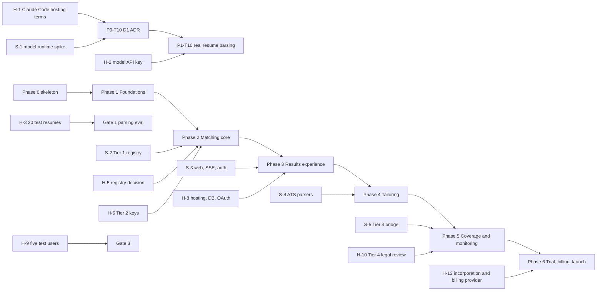

# Implementation Plan: AI Job Matchmaker

Architecture: `docs/architecture/README.md` (ADRs in `docs/architecture/adr/`, deferrals and watch list in `docs/architecture/deferred.md`)
Requirements: `docs/prd.md` (requirement IDs RP, PF, IN, DS, MR, NF, TR, MN, AB; Flows 1 to 8; six-phase release plan)
Plan status: Draft (2026-11-11), awaiting approval
Detail level: Phases 0 to 2 fully detailed. Phases 3 to 6 at title-and-acceptance level; each is detailed at the preceding gate.
Calendar: no launch date is set. The plan uses phases, tasks and S/M/L sizes only. Calibrate throughput after Gate 0 and Gate 1.

## How to use this plan

An executing session reads `PROGRESS.md`, then the current phase file only. Take the next task whose dependencies are done, read the architecture sections it cites, implement it, run its Verify commands plus `pnpm verify`, commit with the task ID in the message, and update `PROGRESS.md` in the same commit. Stop at every phase gate for the human checkpoint. A `HUMAN` task is done only when the user says so; never simulate one.

## Starting point (the real code, surveyed 2026-11-11)

This is not a greenfield build. The Architect left a working skeleton:

| Area | State |
|---|---|
| Toolchain | Node 22 type stripping, pnpm workspaces, TypeScript 6 type-check per package, no build step. `pnpm verify` = typecheck + architecture check + tests. **Green** today (6 tests). No CI, no formatter, no CLAUDE.md. |
| Enforcement | `tools/architecture/check.mjs` with rules as data in `components.mjs`. Probed with injected violations: it catches outward arrows, platform imports in inner circles, cross-area imports, `/wiring` bypass and cycles. It has no regression tests of its own and scans only `src/` and `test/`. |
| Rules (`packages/rules`) | Implemented and pure: gates, evidence rule, Fit, Confidence, Job Quality, verdict, primary reason, priority, distance and lever, selling-point tier, Resume Strength weights, keyword coverage, tailoring guard, access policy, duplicate identity (first stage). Open hand-off: personal-token redaction in `toScoringProfile`. |
| Use cases | Built: `RunJobSearch` (in-memory pipeline with widening and Tier 3 fallback), `ScoreJobs` (cache per profile version and posting revision), `RescoreAll`, `RunFullAnalysis`, `RecheckStoredPostings`, `ListResults`, `RecordJobDecision`, `SignUp`, `ViewAccess`, `StartCheckout`, `ExportMyData`, `DeleteMyData`, `PurgeExpiredAccounts`, `RunDueMonitoring`, `ViewInbox`, `OperateSources`, `AccessGuard`. Stubs (`notYetBuilt`): `IntakeResume`, `CorrectProfile`, `ConductInterview`, `ViewJobDetail`, `ReviewNotAFit`, `TailorResume`, `RecordSubscriptionChange`. |
| Adapters | `InMemoryStore`, `InMemoryUsageLedger`, `SystemClock`, `RandomIds`, `InProcessWorkQueue`, `TemplateNarrator`. Shells: `UnchosenModelRuntime`, `GreenhouseBoardSource`, `JobSpyBoardSource`. |
| Delivery | `ResultsController`, results presenter and view models, access presenter. |
| Main | `composeMatchmaker` wires 11 interactors; `main.dev.ts` runs and prints their names. Monitoring roster is an inline empty stub. |
| Testing API | `MatchmakerTestingApi` composes the real Main with scripted judge and sources; 6 tests through it. |

## Inventory

Existing items are marked **exists**; "Built in" names the task that completes or verifies them.

### Entities (`packages/rules/src`)

| ID | Name | Architecture ref | State | Built in |
|----|------|------------------|-------|----------|
| E-1 | `ProfileVersion`, `Evidence`, `Preferences`, `profileVersionKey` | README "Critical Business Rules", ADR 0005 | exists | P1-T04 (exercised) |
| E-2 | `ScoringProfile` brand and `toScoringProfile` | ADR 0007 §1 | exists; redaction hand-off open | P2-T02 |
| E-3 | Selling-point tier and selection (5 to 8) | PRD RP-4 | tier exists; selection new | P1-T03 |
| E-4 | Resume Strength weights | PRD Resume Strength | exists | P1-T04 (exercised) |
| E-5 | Common job schema `JobPosting` with revision | ADR 0005 §2 | exists | P2-T03 |
| E-6 | Duplicate identity and source-link merge | PRD pipeline step 4 | first stage exists; description similarity new | P2-T03 |
| E-7 | Hard gates | ADR 0002 | exists | P2-T01 |
| E-8 | Evidence rule (`enforceEvidence`) | ADR 0002, 0007 | exists | P2-T01 |
| E-9 | Fit, Confidence, Job Quality, priority | ADR 0002 | exists | P2-T01 |
| E-10 | Verdict, primary reason, distance to Apply, biggest lever | ADR 0002 | exists | P2-T01 |
| E-11 | ATS keyword coverage | ADR 0002 | exists | P4 |
| E-12 | Tailoring guard | ADR 0007 §3 | exists | P4 |
| E-13 | Access policy (trial, banner, retention, fair use) | README "access/" | exists | P1-T06, P6 |
| E-14 | Seniority ladder; suggested target band (RP-6, PF-5 defaults) | PRD Hard gates | ladder exists; suggestion new | P1-T03 |
| E-15 | Points lost and "what would change this verdict" (report parts 5 and 6) | PRD Report contents | new (assumption: belongs in `rules/matching`) | P3 |

### Use cases (`packages/use-cases/src`)

| ID | Name | Area | State | Built in |
|----|------|------|-------|----------|
| UC-1 | `IntakeResume` | onboarding | stub | P1-T04 |
| UC-2 | `CorrectProfile` (facts, selling points; preferences) | onboarding | stub | P1-T05 (facts), P2-T15 (preferences), P3 (screens, Fix a fact) |
| UC-3 | `ConductInterview` | onboarding | stub | P3 |
| UC-4 | `RunJobSearch` | discovery | exists; dedup and revision hand-off | P2-T03 |
| UC-5 | `RecheckStoredPostings` | discovery | exists | P2-T04 (liveness), P5 (daily schedule) |
| UC-6 | `ScoreJobs` | matching | exists | P2-T01 |
| UC-7 | `RescoreAll` | matching | exists; reuse optimization hand-off | P1-T05 (requested), P3 |
| UC-8 | `RunFullAnalysis` | matching | exists; supersede hand-off | P3 |
| UC-9 | `ListResults` | results | exists | P2-T01, P3 |
| UC-10 | `ViewJobDetail` | results | exists (ADR 0012); presenter and screen in P3 | P3 |
| UC-11 | `ReviewNotAFit` | results | stub | P3 |
| UC-12 | `RecordJobDecision` | results | exists | P3 |
| UC-13 | `TailorResume` | tailoring | stub | P4 |
| UC-14 | `RunDueMonitoring` | monitoring | exists; roster stub in Main | P5 |
| UC-15 | `ViewInbox` | monitoring | exists; no `InboxSource` adapter | P5 |
| UC-16 | `SignUp` | account | exists | P1-T06 |
| UC-17 | `ViewAccess` | account | exists | P1-T06 |
| UC-18 | `StartCheckout` | account | exists; no `Checkout` adapter | P6 |
| UC-19 | `RecordSubscriptionChange` | account | exists, idempotent per event id (ADR 0013); ordering (W12) in P6 | P6 |
| UC-20 | `ExportMyData`, `DeleteMyData` | account | exists; no `UserDataVault` adapter | P6 |
| UC-21 | `PurgeExpiredAccounts` | account | exists; `paywalledBefore` returns `[]` | P6 |
| UC-22 | `OperateSources` | operations | exists | P5 |

### Ports (owned by use cases)

| ID | Port(s) | Owner | Fake | Real adapter |
|----|---------|-------|------|--------------|
| P-1 | `Clock`, `IdGenerator` | shared | testing API | `SystemClock`, `RandomIds` (exist) |
| P-2 | `AccountsForAccess`, `UsageLedger`, `Accounts` | shared, account | `InMemoryStore`, `InMemoryUsageLedger` | A-22 (P3) |
| P-3 | `DocumentReader` | onboarding | testing API (P1-T02) | A-15 (P1-T08, P1-T09) |
| P-4 | `ResumeAnalyst` | onboarding | testing API (P1-T02) | A-7 (P1-T10) |
| P-5 | `Interviewer` | onboarding | testing API (P3) | A-12 (P3) |
| P-6 | `ResumeFiles` | onboarding | A-16a in-memory (P1-T01) | A-16b encrypted object storage (P3) |
| P-7 | `ProfileVersions`, `ProfilesForSearch`, `ProfilesForScoring` | onboarding, discovery, matching | `InMemoryStore` | A-22 (P3) |
| P-8 | `InterviewTranscripts` | onboarding | in-memory (P3) | A-22 (P3) |
| P-9 | Request ports `SearchRequests`, `RescoreRequests`, `ScoringRequests`, `MonitoringSearchRequests` | onboarding, discovery, monitoring | `InProcessWorkQueue` via Main | A-25 durable queue (P5, D4) |
| P-10 | `JobSource` | discovery | testing API | A-17 to A-20 (P2, P5) |
| P-11 | `SourceSwitchboard`, `SourceSwitchControl` | discovery, operations | `InMemoryStore` | A-26 flag store (P3 with D2, or P5) |
| P-12 | `SearchPlanner` | discovery | testing API | A-9 (P2-T11) |
| P-13 | `PostingEnricher` | discovery | testing API | A-10 (P2-T11) |
| P-14 | `RelevanceRanker` | discovery | testing API | A-11 (P2-T13) |
| P-15 | `PostingCatalog`, `PostingsForScoring` | discovery, matching | `InMemoryStore` | A-22 (P3) |
| P-16 | `PostingLiveness` | discovery | testing API | A-21 (P2-T04) |
| P-17 | `SearchRuns`, `SearchRunHistory` (with `runId` and `costMicros`, ADR 0010) | discovery, operations | `InMemoryStore` | A-22 (P3) |
| P-18 | `AtsLinkRecognizer`, `CompanyRegistry` | discovery | `InMemoryStore` | Tier 1 adapters; A-22 |
| P-19 | `MatchJudge` | matching | testing API | A-8 (P2-T12) |
| P-20 | `MatchNarrator` | matching | — | `TemplateNarrator` (exists); model narrator only on W4 trigger |
| P-21 | `MatchRecords` | matching | `InMemoryStore` | A-22 (P3) |
| P-22 | `ResultsFeed` (output port) | matching | testing API | A-27 server-sent events in `apps/web` (P3) |
| P-23 | `ResultsReadModel` | results | `InMemoryStore` | A-22 (P3) |
| P-24 | `TailoringSources`, `TailoredResumes` | tailoring | in-memory (P4) | A-22 (P4) |
| P-25 | `KeywordMatcher` | tailoring | testing API (P4) | A-13 (P4) |
| P-26 | `ResumeWriter` | tailoring | testing API (P4) | A-14 (P4) |
| P-27 | `ResumeRenderer` | tailoring | testing API (P4) | A-23 (P4) |
| P-28 | `GeneratedFiles` | tailoring | in-memory (P4) | A-24 (P4) |
| P-29 | `MonitoringRoster`, `InboxSource` | monitoring | in-memory (P5) | A-22 (P5) |
| P-30 | `Checkout` | account | testing API (P6) | A-28 (P6, D7) |
| P-31 | `UserDataVault` | account | in-memory (P6) | A-22 plus file stores (P6) |
| P-32 | `SpendMeter`, `SpendAttribution`, `SpendLedger` (ADR 0010) | shared | `AsyncSpendMeter`, `InMemorySpendLedger` (exist) | `AsyncSpendMeter` stays; ledger in A-22 (P3) |
| P-33 | `ProductEvents` (ADR 0011) | measurement | `InMemoryProductEventLog` (exists) | D14: own table in A-22 or a vendor adapter (P3-T14) |

### Adapters, delivery, Main, cross-cutting

| ID | Kind | Name | Layer / package | Ref | Built in |
|----|------|------|-----------------|-----|----------|
| A-1 | Adapter (P-2, P-7, P-11, P-15, P-17, P-18, P-21, P-23) | `InMemoryStore` (exists) | `adapters/in-memory` | ADR 0006 | P0-T06 (contracts) |
| A-7 | Adapter (P-4) | Resume analyst, model-backed | new model-runtime package | ADR 0003, D1 | P1-T10 |
| A-8 | Adapter (P-19) | Match judge, model-backed | model-runtime package | ADR 0002, 0003 | P2-T12 |
| A-9, A-10 | Adapter (P-12, P-13) | Search planner, posting enricher | model-runtime package | ADR 0003 | P2-T11 |
| A-11 | Adapter (P-14) | Relevance ranker | model-runtime package or adapters | D3 | P2-T13 |
| A-12 | Adapter (P-5) | Interviewer | model-runtime package | W7 | P3 |
| A-13, A-14 | Adapter (P-25, P-26) | Keyword matcher, resume writer | model-runtime package | ADR 0007 | P4 |
| A-15 | Adapter (P-3) | Document reader: text, DOCX, PDF, LinkedIn PDF, OCR | new `@matchmaker/documents` (W2 split) | D9 | P1-T08, P1-T09 |
| A-16 | Adapter (P-6) | Resume files: in-memory (a), encrypted object storage (b) | adapters | D8 | P1-T01, P3 |
| A-17 | Adapter (P-10, P-18) | Tier 1 ATS: Greenhouse, Lever, Ashby, Workable, SmartRecruiters, Recruitee | `adapters/job-sources` | ADR 0004 | P2-T05 to P2-T07 |
| A-18 | Adapter (P-10) | Tier 2: Remotive, RemoteOK, Arbeitnow, Jobicy, Himalayas, The Muse, Adzuna, USAJobs, We Work Remotely, HN Who's Hiring | `adapters/job-sources` | ADR 0004 | P2-T08 to P2-T10 |
| A-19 | Adapter (P-10) | Tier 3: JSearch, SerpApi, TheirStack, Apify | `adapters/job-sources` | ADR 0004 | P5 |
| A-20 | Adapter (P-10) | Tier 4 scraping | `scraping-sources` | ADR 0004, D11, W6 | P5 |
| A-21 | Adapter (P-16) | HTTP posting liveness | `adapters/job-sources` | — | P2-T04 |
| A-22 | Adapter (all storage gateways) | Postgres storage with migrations | new `@matchmaker/storage-postgres` | D2 | P3 |
| A-23 | Adapter (P-27) | ATS-safe PDF and DOCX renderer | `@matchmaker/documents` | D9 | P4 |
| A-24 | Adapter (P-28) | Generated files store | adapters | D8 | P4 |
| A-25 | Adapter (P-9) | Durable queue | adapters or own package | D4, W5 | P5 |
| A-26 | Adapter (P-11) | Flag store for kill switches | with A-22 | D10 | P3 or P5 |
| A-27 | Adapter (P-22) | Server-sent events results feed | `apps/web` | D5 | P3 |
| A-28 | Adapter (P-30) | Billing provider checkout and webhook listener | adapters, `apps/web` | D7 | P6 |
| A-29 | Adapter (P-32) | `AsyncSpendMeter` (exists) and `InMemorySpendLedger` (exists) | `adapters/metering`, `adapters/in-memory` | ADR 0010 | done |
| A-30 | Adapter (P-33) | `InMemoryProductEventLog` (exists); real destination | `adapters/in-memory`; D14 | ADR 0011 | P3-T14 |
| D-1 | Delivery | Results controller and presenters (exist) | delivery | README | P2-T01 |
| D-2 | Delivery | Access presenter (exists) | delivery | README | P1-T06 |
| D-3 | Delivery | Onboarding controllers and presenters (selling-points card, corrections) | `delivery/onboarding` | ADR 0001 §7 | P1-T07 |
| D-4 | Delivery | Preferences and interview controllers and presenters | `delivery/onboarding` | — | P3 |
| D-5 | Delivery | Job detail and Not a fit presenters | `delivery/results` | — | P3 |
| D-6 | Delivery | Tailoring presenter | `delivery/tailoring` | — | P4 |
| D-7 | Delivery | Inbox presenter; operator console | `delivery/monitoring`, `delivery/operations` | — | P5 |
| D-8 | Frameworks and drivers | `apps/web`: route handlers, authentication, screens | `apps/web` (a Main) | D5, D6 | P3 |
| D-9 | Frameworks and drivers | `apps/worker`: scheduler and queue consumer | `apps/worker` (a Main) | D4 | P5 |
| D-10 | Frameworks and drivers | Dev drivers (`smoke`, `intake`, `search`) | `apps/main/src/main.dev.ts` | README "Main" | P0-T05, P1-T12, P2-T16 |
| M-1 | Main | `composeMatchmaker` | `apps/main` | README "Main" | every slice |
| M-2 | Main | Testing API (`MatchmakerTestingApi`) | `packages/testing-api` | ADR 0008 | P0-T04, every slice |
| M-3 | Main | Per-market configurations | `apps/web`, `apps/worker` | ADR 0004, W10 | P5, P6 |
| X-1 | Cross-cutting | Error model (`UseCaseError`) | use-cases/shared | — | P0-T04 (verify), P1-T04 |
| X-2 | Cross-cutting | Configuration and secrets (typed env loader in Main) | Main | — | P1-T10 |
| X-3 | Cross-cutting | Boundary enforcement (typecheck, check, metrics) | tools | ADR 0001 §5 | P0-T02, P0-T03 |
| X-4 | Cross-cutting | CI | `.github/workflows` | — | P0-T09 |
| X-5 | Cross-cutting | Evaluation harness (parsing, stability, ATS parse, coverage) | `apps/main/eval` (a Main configuration) | ADR 0002, 0008 | P0-T07, P1-T11, P2-T14, P4 |
| X-6 | Cross-cutting | Adapter contract suites | `packages/testing-api/contract` | — | P0-T06 and every adapter task |
| X-7 | Cross-cutting | Encryption at rest and in transit (Privacy 1) | storage adapters | D2, D8 | P3 |
| X-8 | Cross-cutting | Fairness redaction | rules | ADR 0007 | P2-T02 |
| X-9 | Cross-cutting | Model-provider data terms (no training, Privacy 4) | Main configuration | W10 | H-2 |
| X-10 | Cross-cutting | Database migrations | storage-postgres | D2 | P3 |
| X-11 | Cross-cutting | Formatting and lint | root | — | P0-T08 |
| X-12 | Cross-cutting | Spend metering: every paid adapter records through `SpendMeter`; every cost-incurring use case charges | adapters, use cases | ADR 0010 | every paid-adapter task |
| X-13 | Cross-cutting | Product events: measured decorators over input ports, wired in Main | `use-cases/src/measurement` | ADR 0011 | every task that wires a measured use case |

## Layers and the dependency rule

| Layer | Directory | May import | Must never import |
|-------|-----------|------------|-------------------|
| Entities | `packages/rules/src` | its own files only | every other package, `node:*`, any library |
| Use cases | `packages/use-cases/src` (areas never import each other; `shared` is open to all) | `@matchmaker/rules` | adapters, delivery, main, `node:*`, any library; another area |
| Interface adapters: delivery | `packages/delivery/src` | `@matchmaker/use-cases` (published types only) | rules, adapters, main, `/wiring`, `node:*`, any library |
| Interface adapters and drivers | `packages/adapters/src`, `packages/scraping-sources/src`, and split packages (`documents`, model runtime, `storage-postgres`) | rules, use-cases, `node:*`, their own libraries | delivery, main, testing-api, `/wiring`; another adapter subfolder |
| Main | `apps/main/src` (later also `apps/web`, `apps/worker`) | everything above, including `/wiring` | testing-api (nothing imports a Main except the testing API) |
| Tests | `packages/testing-api` | everything | — (nothing imports it). Tests in `test/` talk only to `MatchmakerTestingApi` (ADR 0008) |

Enforced by: per-package `tsc` with manifest-scoped resolution and `types: []` for inner circles, plus `tools/architecture/check.mjs` (rules as data in `tools/architecture/components.mjs`), run as `pnpm verify`. Changing `components.mjs` needs an ADR; tasks that split a package under watch-list item W2 record it through `/architect`.

## Phases

The PRD's six release phases are kept as phase goals, and their exit tests are the gates. Phase 0 comes first.

| Phase | Goal (one sentence a non-engineer can verify) | Slices / use cases | Tasks | File |
|-------|-----------------------------------------------|--------------------|-------|------|
| 0 | `pnpm verify` and CI are green on every push, a trivial request runs through every layer from the dev Main, and the model runtime decision is recorded | skeleton, X-3 to X-6, D1 decision | 10 + S-1, H-1 | `phase-0-skeleton.md` |
| 1 | **Foundations.** A resume dropped into the dev app becomes a structured profile with a selling-points card and a Resume Strength score. **Exit: 20 varied test resumes parse with correct roles, dates and skills** | UC-1, UC-2 (facts), UC-16, UC-17 | 12 + S-2 | `phase-1-foundations.md` |
| 2 | **Matching core.** A search over real Tier 1 and 2 sources gives every job a verdict. **Exit: score stability holds at 95% on a fixed test set** | UC-2 (preferences), UC-4, UC-5, UC-6, UC-9 | 16 | `phase-2-matching-core.md` |
| 3 | **Results experience.** Real people sign up on the web, finish onboarding and see their three tabs. **Exit: five test users reach a first Apply verdict in under 10 minutes** | UC-2, UC-3, UC-7, UC-8, UC-10, UC-11, UC-12; D2, D5, D6, D8 | 15 (outline) | `phase-3-results-experience.md` |
| 4 | **Tailoring.** A user gets a tailored resume per job without anything invented. **Exit: tailored resumes parse cleanly in three common ATS parsers** | UC-13 | 8 (outline) | `phase-4-tailoring.md` |
| 5 | **Full coverage and monitoring.** All four tiers, kill switches, scheduled runs and the inbox. **Exit: a run completes with any single source disabled** | UC-5, UC-14, UC-15, UC-22; D4, D10, D11 | 8 (outline) | `phase-5-coverage-and-monitoring.md` |
| 6 | **Trial, billing and launch.** **Exit: a full signup-to-payment path works end to end** | UC-18 to UC-21; D7 | 8 (outline) | `phase-6-trial-billing-launch.md` |

## Dependency graph

## Risks and how the sequence addresses them

| Risk | Likelihood / impact | Addressed by |
|------|---------------------|--------------|
| Claude Code may not be usable as the hosted runtime agent, or its terms forbid it | M / H | H-1 and S-1 in Phase 0; P0-T10 records D1 before P1-T10. ADR 0003 means a "no" changes only adapters. |
| The PRD's "temperature 0" consistency rule cannot be met literally: current Claude models reject sampling parameters (`temperature`) with a 400 | H / M | S-1 confirms. Stability then rests on structured output, a fixed rubric, the evidence rule, caching per profile version (ADR 0005) and the rules deciding (ADR 0002). The Phase 2 exit (95% within 3 points) is the measure. Open question 2. |
| Resume parsing quality below the Phase 1 exit | M / H | Parsing eval (P1-T11) runs from the first real adapter; scripted-analyst tests prove the use case independently of model quality. |
| Judge variance breaks the 95% stability target | M / H | Stability eval (P2-T14) runs as soon as A-8 exists; caching makes production stable regardless (ADR 0005); calibration stays in rules. |
| Job source endpoints, quotas and terms changed since the PRD | H / M | Every source adapter task starts by verifying the endpoint in current documentation; recorded fixtures keep tests offline; a failing source never fails a run (exists). |
| No initial Tier 1 company registry | H / H (Tier 1 returns nothing) | S-2 and H-5 in Phase 1, before Tier 1 adapters in Phase 2. |
| JobSpy is a Python library; the stack is TypeScript | H / M | S-5 during Phase 4 decides a bridge (subprocess or sidecar) and whether watch item W6 fires. |
| Cost per user above an unset price | M / H | S-6 builds a cost model from Phase 2 measurements; H-16 confirms caps and interval before Phase 5. Cost metering is decided (ADR 0010): run cost and spend per user are recorded from the first paid adapter. |
| Web framework, streaming and authentication arrive late, threatening the 10-minute test | M / M | S-3 at the end of Phase 2; web work opens Phase 3. Controllers and presenters are framework-free already. |
| Tier 4 legal review takes long | H / M | H-10 starts now; the product must work on Tiers 1 to 3 alone (exists). |
| The architecture check quietly loosens | L / H | P0-T02 adds regression tests for every rule in the checker. |

## Spikes

Spike code lives on a throwaway branch and is not merged. Each answer is appended below and the decision recorded (ADR via `/architect` when architectural).

| ID | Question | Time box | Feeds decision | Scheduled |
|----|----------|----------|----------------|-----------|
| S-1 | For each model port (analyst, planner, enricher, ranker, judge, interviewer, writer, matcher): Claude Code headless, the Claude Agent SDK, or the direct Messages API? Can each meet structured output, latency (card in 20 s, first result in 60 s), no-training data terms and cost? Is an embeddings source available, or does `RelevanceRanker` need another provider? | One session | D1, D3; P0-T10 | Phase 0 |
| S-2 | Where can an initial list of employer identifiers per ATS come from (public lists, Tier 2 links), and how large is it? | One session | Registry seed for P2-T05 to P2-T07; H-5 | Phase 1 |
| S-3 | Web framework, SSE transport and authentication on the chosen host: does Next.js plus SSE (the PRD default) stream `ResultsFeed` within the 60 s first-result target, and which auth library fits email plus Google? | One session | D5, D6; Phase 3 tasks | End of Phase 2 |
| S-4 | Which three common ATS parsers can be run repeatably (API, trial account, open-source parser) for the Phase 4 exit? | One session | Phase 4 ATS-parse eval | Phase 3 |
| S-5 | Tier 4: JobSpy (Python) via subprocess or sidecar versus a TypeScript scraper; does it force the W6 process boundary? | One session | D11, W6; Phase 5 Tier 4 tasks | Phase 4 |
| S-6 | Cost model per active user from Phase 2 measurements: prefilter cap 150, fair-use caps, 12 h monitoring | One session | H-16 (open questions 7 and 8 of the PRD) | Phase 3 |

## HUMAN tasks

| ID | What | Blocks | Needed by | Start |
|----|------|--------|-----------|-------|
| H-0 | Commit your untracked `docs/prd.md` and the uncommitted `docs/architecture/README.md` edit (the plan cites both) | P0-T01 | Phase 0 | Now |
| H-1 | Settle PRD open question "How is Claude Code run as a hosted runtime agent, and do its terms allow it for a consumer product?" from Anthropic's current terms and documentation, and with Anthropic if needed | P0-T10, then P1-T10 (real resume parsing) | Before P1-T10 | Now |
| H-2 | Create the model provider account chosen in P0-T10; configure no-training data settings (Privacy 4); put the API key in the dev and CI secret stores | P1-T10 | Phase 1 | After P0-T10 |
| H-3 | Supply 20 varied test resumes you have consent to use (PDF, DOCX, pasted text, LinkedIn export; new graduate, career changer, long history, gaps) and review the agent-drafted ground truth | P1-T11, Gate 1 | Gate 1 | Now |
| H-4 | DONE (user delegated; default stands). What "parse correctly" means: every role's employer, title, start and end month exact; skills precision and recall at least 90% per resume) | P1-T11 | Gate 1 | Gate 0 |
| H-5 | Choose the initial Tier 1 company registry source after S-2 (PRD open question 6) | P2-T05 to P2-T07 | Phase 2 | Phase 1 |
| H-6 | Obtain Adzuna and USAJobs API keys | P2-T09 | Phase 2 | Phase 1 |
| H-7 | Approve the fixed stability test set; confirm calibration values in deferred.md D13 (source reliability ratios, reason precedence, two-Missing rule, Tier 3 fallback, widen threshold 20) | Gate 2 | Gate 2 | Phase 2 |
| H-8 | Provision hosting, domain, Postgres, object storage with encryption at rest, a Google OAuth client and an email-sending provider | Phase 3 web and storage tasks | Phase 3 | Phase 1 |
| H-9 | Recruit five test users, with consent, for the Phase 3 exit test | Gate 3 | Gate 3 | Phase 2 |
| H-10 | Legal review of Tier 4 boards per launch market (PRD open question 5) | Phase 5 Tier 4 | Phase 5 | Now (long lead) |
| H-11 | Tier 3 accounts and keys (JSearch, SerpApi, TheirStack, Apify), a spend budget, and a proxy pool if Tier 4 is cleared | Phase 5 | Phase 5 | Phase 3 |
| H-12 | Access to the three ATS parsers chosen in S-4 | Gate 4 | Gate 4 | Phase 3 |
| H-13 | Decide the country of incorporation and hence the billing provider (PRD open question 3); open a sandbox account | Phase 6 | Phase 6 | Now (long lead) |
| H-14 | Set the monthly price and whether a card is required to start the trial (PRD open questions 1 and 2) | Phase 6 | Phase 6 | Phase 4 |
| H-15 | Privacy policy and data-processing terms per launch market (Privacy 5); the product's name (PRD open question 9) | Gate 6 | Phase 6 | Phase 4 |
| H-16 | After S-6, confirm the monitoring interval, fair-use caps and the 150-job scoring cap (PRD open questions 7 and 8) | Phase 5 | Phase 5 | Phase 3 |

## Assumptions

- **Tests talk to the testing API.** ADR 0008 says business tests talk only to `MatchmakerTestingApi`, and the architecture check forbids `node:*` in `packages/rules`, so there are no per-file unit tests in inner packages. Rules and use cases are tested through testing-API operations with scripted details. Revisit if a rule needs a test the testing API cannot express (add the superpower, per ADR 0008's trigger).
- **Adapter contract suites live in `packages/testing-api/contract/`.** ADR 0008 governs business tests in `test/`; adapter conformance tests import adapters directly and run against the in-memory fake and each real adapter. Confirm with the Architect at Gate 0.
- **Evaluations are a Main configuration** under `apps/main/eval/`, run by `pnpm eval:<name>`, outside `pnpm verify` (they spend money and need keys). This follows "one Main per configuration" (README "Main", ADR 0008).
- **Web delivery starts in Phase 3, not Phase 1.** Phase 1 and 2 exits are evaluations that need no UI; the PRD's Phase 1 "Accounts" is met at the use-case level (`SignUp` and `ViewAccess` exist), and a dev driver shows the card. D5 and D6 fire when Phase 3 UI work starts. See open question 1.
- **Package splits under W2** (`@matchmaker/documents` in P1-T08, a model-runtime package in P1-T10, `@matchmaker/storage-postgres` in Phase 3) are the action the Architect pre-approved in `deferred.md`; each is still recorded as an ADR through `/architect` because `components.mjs` changes.
- **Formatter and linter:** Biome, as one root dev dependency, run as a check in `pnpm verify`. Replace if the user prefers another.
- **Description-similarity deduplication** (PRD pipeline step 4, second stage) is a pure rule in `rules/jobs` with a threshold constant to calibrate (D13 style).

## Open questions: answered by the user (2026-11-11)

1. **Web demo in Phase 1:** no. Web delivery starts in Phase 3, as planned.
2. **"Temperature 0":** accepted. The rule is replaced by "structured output, fixed rubric, cached judgments"; the Phase 2 exit (95% of re-scores within 3 points) stays the measure. Recorded as ADR 0009 when S-1 confirms the API fact.
3. **Parsing thresholds (H-4):** the user delegated this; the plan's default stands. Every role's employer, title, start and end month exact; skills precision and recall at least 90% per resume.
4. **Cost metering and analytics events:** decided by `/architect`. ADR 0010 (spend metered at the edge, charged by the use case; SearchRun cost; spend per user) and ADR 0011 (product events from decorators over input ports in a measurement area; destination deferred as D14).
5. **Evidence text for job detail:** decided in ADR 0012 (`ResultsReadModel.jobDetail` returns evidence from the match's own profile version; `ViewJobDetail` implemented).
6. **Idempotent subscription changes:** decided in ADR 0013 (`SubscriptionChange.eventId`; atomic `Accounts.applySubscriptionEvent`; `RecordSubscriptionChange` implemented; ordering is W12).
7. **Test placement:** approved. Adapter conformance tests in `packages/testing-api/contract/`, evaluations in `apps/main/eval/`.

## Deferred decisions honored

- D1 model runtime: forced now by the user's instruction; decided in P0-T10 after H-1 and S-1, before P1-T10.
- D2 database: in-memory through Phase 2; `storage-postgres` in Phase 3, forced by the five real test users (Gate 3), with migrations (X-10) and encryption at rest (X-7).
- D3 vector search: decided with D1 in S-1 and built in P2-T13.
- D4 background work: `InProcessWorkQueue` until Phase 5, forced by monitoring running without web traffic.
- D5, D6 web and authentication: S-3 at the end of Phase 2; built at the start of Phase 3.
- D7 billing: Phase 6, forced by H-13.
- D8 file storage: in-memory in Phase 1 (P1-T01), encrypted object storage in Phase 3.
- D9 document libraries: P1-T08 (reading), Phase 4 (rendering).
- D10 flag store: with D2 in Phase 3.
- D11 scraping library: S-5 in Phase 4; Phase 5 only for boards cleared by H-10.
- D12 service split: not planned. Watch W5 and W6 in Phase 5.
- D13 calibration values: kept as constants; confirmed at Gate 2 (H-7) and Gate 4 (H-16).
- Watch list: review `deferred.md` at every gate (each gate's human checkpoint says so).

## Spike answers

(Appended by each spike.)
